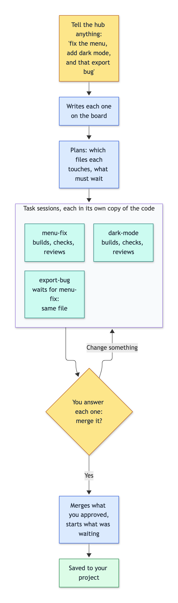

# Claude Build Kit

Tell Claude an idea in your own words, and it builds it with you, on your own computer. You don't
write any code. Claude writes it, checks its own work, and asks you one simple question at a time.

This kit is a set of instructions and safety checks for Claude Code. You set it up once by pasting
one line into Claude, and Claude does the rest. Ready already? [Jump to Start](#start).

## What you can make

- **A website for your business:** your services, photos, prices and a contact form.
- **A booking or portfolio site:** show off your work, or let people pick a time.
- **A small app or tool that saves you time:** say, one that sorts a folder of photos, or turns a
  pile of receipts into a spreadsheet. It can run on your computer or your phone.
- **A video or animation:** an animated explainer, captions for your clips, a short promo.
- **Research:** a report on a business idea or a market, or a pitch deck, with a clear verdict.

**How long it takes:** getting your computer ready takes 10 to 15 minutes, once. After that, a
simple first version (a one-page website, a small tool) often takes an hour or two of chatting.
Bigger ideas grow from there, one change at a time.

**What you do:** answer Claude's questions, look at what it made, and say yes or ask for changes.

## Words you'll see

These are the only terms you need. Claude explains anything else as it goes.

- **Claude Code:** Claude that can work with files on your computer. It can make folders, write
  files and run programs, not just chat. It's the **Code** tab in the Claude desktop app.
- **Terminal:** a window where you type commands to your computer. You'll rarely need it: Claude
  types the commands itself.
- **Session:** one conversation with Claude Code, inside one project folder.
- **Agent:** a specialist role Claude takes on, like designer or security reviewer.
- **Skill:** a written playbook Claude follows for one kind of job, like starting a new project.
- **Plugin:** an add-on that gives Claude extra skills or tools.
- **Connector:** lets Claude read an app you already use, like Notion or Google Drive. You sign in
  yourself.
- **Hook,** called a **guard** here: an automatic safety check. It runs before Claude does certain
  things, and stops it if something looks dangerous.
- **Git:** save points for your project, so you can always go back to a version that worked.
- **Repo** (short for repository): a project folder with its save points. This page is one.
- **GitHub:** a website that stores repos online. You only need it to back up or share a project.

## What gets installed, and what it does for you

It all goes in your Claude Code folder: a hidden folder called `.claude` in your home folder. Claude
tells you what each piece is before installing it, and all of it can be removed
([how](#updating-and-removing)).

**The kit itself**

- **new-project** (skill): takes you from idea to a working first version. It interviews you,
  writes the plan, builds, and checks its own work. *So you get something real, not just advice.*
- **hub-workflow** (skill): builds several changes at once, and brings each one to you for a yes.
  *So a list of ideas gets done side by side.*
- **unslop** (skill): makes screens look designed, not generic or AI-made. *So your site has its
  own look.*
- **Two secret guards:** stop Claude from showing a password or access key in the chat, or saving
  one into a file that could end up online. *So your logins stay private.*
- **Delete guard:** blocks anything that would wipe your home folder or a disk, and asks you first
  before other risky deletes. *So one slip can't wipe your work.*
- **Long-chat guard:** when a chat gets long, Claude saves notes and carries on in a fresh session.
  *So nothing you agreed on gets forgotten.*

**Starter pack** (recommended; you can skip it)

- **mattpocock-skills** (plugin): lets Claude interview you properly, and test and fix code. *So
  it builds what you meant, and it works.*
- **ui-ux-pro-max** (plugin): a design library of styles, colours and fonts. *So anything with a
  screen looks designed.*
- **playwright** (plugin): lets Claude open your website in a browser and click through it. *So it
  checks its own work before showing you.*
- **ponytail** (plugin): makes Claude keep every change as small and simple as it can, and end each
  reply with what it skipped or didn't check. *So there's less that can break, and you know what's
  left.* It's on in every chat: say "normal mode" to switch it off for one chat, or ask Claude to
  remove it. It also shows a small bar above where you type with what each task used (the cost
  there is an estimate, not a bill); type `/ponytail band` to hide it.
- **Agency Agents:** a catalogue of about 280 specialist roles. *Each project uses only the few it
  needs.*

**Basic tools** (only if your computer doesn't have them yet; all free and widely used)

- **git:** save points, as above. *So your work is never lost.*
- **Python:** runs the kit's installer and guards.
- **Node.js:** runs websites on your computer while Claude builds them.
- **Claude Code's terminal tool:** lets Claude install plugins for you.
- **Homebrew** (Mac only): an app store for developer tools. *So Claude can install the rest
  without bothering you.*

For these you might click **Install** in a pop-up, or type your computer's password once into the
Terminal app. Claude tells you exactly where. It never sees your password.

More extras (search ranking, video, research and more) are in [EXTRAS.md](EXTRAS.md). Claude
suggests only the ones that fit your project.

## What you need

- **A paid Claude plan.** Claude Code needs one. Bigger plans let you build more at once.
- **A Mac, Windows PC or Linux computer.** The safety guards and the installer are tested on all
  three every time the kit changes. The full first-time setup has been tried on a Mac.
- **Nothing else to buy.** The kit, the starter pack and the basic tools are all free.
- **Accounts only if you want them.** Some extras need one, like GitHub (free) to back up and
  share projects, or a hosting service to put a website online. You create those yourself: Claude
  never signs up, signs in or pays for anything for you.

## Start

1. Get the [Claude desktop app](https://claude.com/download), sign in, and open the **Code** tab.
   (Already use `claude` in a terminal? That works too.)
2. Make a new, empty folder for your idea (in Documents, say) and pick it in the Code tab.
3. Paste this:
   ```
   Set me up with https://github.com/aidanmascaro-ctrl/claude-build-kit
   ```
4. Answer its questions, then tell it your idea.

Claude reads [SETUP.md](SETUP.md) and takes it from there.

**The first time,** Claude checks your computer, installs what's listed above, offers to connect
Notion, Google Drive or GitHub (you sign in yourself), and usually asks for one restart.

**After that,** starting a project is just: open a new folder, describe your idea. Claude
remembers your setup and keeps the explanations shorter as you get used to it.

## How you use it, at a glance

Yellow boxes are you; blue boxes are Claude. The first part happens once. After that, every
project starts at "Describe your idea".

<p align="center"></p>

Two phrases worth remembering:
- **"continue my project"**: after any restart, it picks up exactly where it stopped.
- **"be the hub"**: once the first version works, it builds several changes at the same time.
  Each one still comes back to you with its own single question.

## What happens next

1. **It gets to know you.** One question: how much you code, so it pitches everything right.
2. **You describe your idea.** Rough is fine.
3. **It asks about your notes.** Got a notes folder or Obsidian vault, Notion pages, Google Drive
   docs or a website about this? It reads them first, so it doesn't ask what you've already
   written down. It only reads; it never edits your notes. What it learns stays in a file on your
   computer that isn't uploaded anywhere.
4. **It pushes back.** One question at a time: who it's for, what "done" looks like, what to leave
   out. It'll challenge the idea if something's off. For a business idea, you get a verdict: go,
   clarify or stop.
5. **It picks the tools.** Each kind of project has a kit (website, app, video, media pipeline,
   research) of specialist agents and plugins. It suggests the ones that fit, and installs only
   what you say yes to.
6. **It writes the plan.** `SPEC.md` (what it does and doesn't do) and, if there's a screen,
   `DESIGN.md` (how it looks). You approve both.
7. **It builds a first version,** with a self-check that clicks through it and screenshots every
   step. You try it.
8. **It keeps building,** one change at a time, or several at once (below).

## Building several things at once

When you have a list of changes, say "be the hub". That session becomes the project's **hub**:
- you tell it anything, any time: a bug, five ideas at once, a half-thought;
- it writes every item down on a board first, so nothing gets lost;
- it opens a separate **task session** for each change, each in its own copy of the code;
- each task builds, checks itself, gets a security review, and asks you one question: "Here's what
  changed. Merge it?" (merge means: add this change to the real project);
- the hub merges what you approve.

Yellow is you, blue is the hub, teal is the task sessions.

<p align="center"></p>

In the desktop app the hub opens the task sessions itself, which is the easy way if you don't
code. In a terminal it gives you one line to paste into a new tab for each task. Every task session
uses your plan's usage, so on smaller plans keep it to two at a time.

## Your safety

- Nothing is uploaded to GitHub, put online, posted, sent, bought or deleted for good without your
  yes.
- Your notes are read, never changed, and what Claude learns from them stays in a file in your
  project that's never uploaded.
- Passwords and keys go in a private file (`.env`) that's never uploaded either.
- Claude never signs up, signs in or pays for anything on your behalf.

## Updating and removing

- **Update:** tell Claude "update my build kit".
- **Check it's working:** `python3 ~/.claude/build-kit/install.py --check` (on Windows, type
  `python` instead of `python3`)
- **Remove it:** ask Claude to "remove the build kit", or run
  `python3 ~/.claude/build-kit/install.py --uninstall`. That takes out the skills, the guards and
  their settings, and leaves your own settings and skills alone. Then delete the
  `~/.claude/build-kit` folder (and `~/.claude/agency-agents`, if it's there).
- **Remove a plugin:** ask Claude, or run `claude plugin uninstall <name>@<marketplace>`.
- The basic tools stay. They're standard programs, and you can remove them like any other.

## What's in this repo

```
SETUP.md        what Claude does when you paste the link
install.py      installs, checks, updates and removes the kit
skills/         new-project, hub-workflow and unslop
hooks/          the four guards
kits/           tools per project type: website, app, video, media-pipeline, research
EXTRAS.md       optional plugins, agents, connectors and tools, with install lines
tests/          self-checks for the guards and the installer (python3 install.py --check)
docs/diagrams/  the two diagrams above: .mmd source (Mermaid) and .png. To change one, edit the
                .mmd, paste it into mermaid.live and export a PNG

```

## Credits

The destructive-command guard is a fresh, smaller take on the idea behind gstack's `/careful`.
The `unslop` skill is by Damir Sokolovsky ([@heydamir](https://x.com/heydamir)), licensed
[CC BY 4.0](https://creativecommons.org/licenses/by/4.0/) and included unchanged; the MIT licence
below doesn't cover it. The agents come from [Agency Agents](https://github.com/msitarzewski/agency-agents). The starter-pack
plugins and those in EXTRAS.md belong to their authors. Everything else in this kit is MIT licensed: use it, change it, share it.
